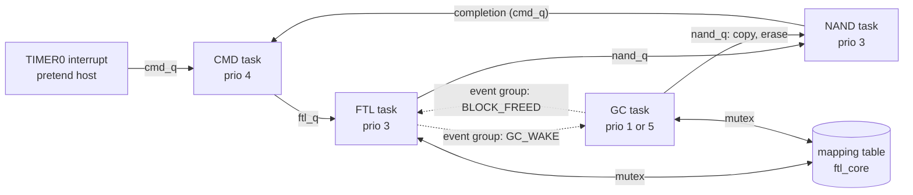

# rtos-ssd-lab

**English** | [繁體中文](README.zh-TW.md)

This repo is where I practice RTOS basics. An RTOS (real-time operating system) is the small OS many firmware projects use to decide which piece of work runs next. SSD controller firmware is a set of jobs competing for the CPU too: taking host commands, looking up the mapping table, moving data, and garbage collection.

I use FreeRTOS on the Arm Cortex-M3 board (mps2-an385) that QEMU emulates, so no hardware is needed. There are two parts:

1. Three RTOS exercises: preemption, interrupt + queue, priority inversion, each with measured numbers.
2. A small SSD firmware: the FTL core of my other project, [ftl-sim](https://github.com/KJLavender/ftl-sim), rewritten in C and split into FreeRTOS tasks, then measured for how GC (garbage collection) affects the latency the host sees.

## Setup

On Linux or Ubuntu under WSL2:

```bash
sudo apt install gcc-arm-none-eabi libnewlib-arm-none-eabi qemu-system-arm make python3
git clone --recurse-submodules <this repo's URL>
cd rtos-ssd-lab
```

Versions I used: arm-none-eabi-gcc 14.2, QEMU 10.2, FreeRTOS-Kernel V11.3.3 (a git submodule under `third_party/`).

## Running

```bash
make run EX=ex01_preemption              # exercise 1, preemptive scheduler
make run EX=ex01_preemption PREEMPT=0    # exercise 1, cooperative scheduler
make run EX=ex02_isr_queue               # exercise 2
make run EX=ex02_isr_queue VARIANT=BAD_ISR_PRIO   # exercise 2 with a wrong interrupt priority
make run EX=ex03_priority_inversion      # exercise 3
make run EX=ex04_mini_ssd                # small SSD firmware (about 20 s)
make ftl-test                            # FTL core test on Linux (needs gcc)
make results                             # run everything, save output to results/
```

Each exercise stops QEMU when it finishes. To quit by hand, press `Ctrl+A` then `X`.

---

## Part 1: RTOS basics

### Exercise 1: preemption

Two tasks. L has low priority and works all the time, adding one to its progress counter per 1 ms of work. H has high priority, wakes every 500 ms and does 2 ms of work. Each time H wakes it records how long it took from its tick to actually getting the CPU, and whether L's counter moved while H was running.

| Scheduler | H wake latency (avg) | H wake latency (max) |
|---|---|---|
| Preemptive | 7 µs | 7 µs |
| Cooperative (L yields every 50 ms) | 19.7 ms | 37.5 ms |

With preemption, L stops as soon as H wakes, and L's counter does not move during H's 2 ms (e.g. `L progress 497 -> 497`). With the cooperative scheduler, H has to wait until L gives up the CPU, which can take up to L's 50 ms yield interval. The average in the table depends on how many rounds run; the point is that the upper bound is set by L, and H has no say in it.

### Exercise 2: interrupt + queue (ISR → task)

TIMER0 fires every 700 µs and pretends to be the host sending a command. The ISR (interrupt handler) only stamps the command with a time and pushes it into a queue with `xQueueSendFromISR`. A handler task does the real work (200 µs per command). It waits in `xQueueReceive` and sleeps while the queue is empty.

The same 1000 commands run twice. The only difference is whether the ISR ends with `portYIELD_FROM_ISR`:

| ISR ending | received / sent | lost | out of order | ISR → task latency (avg / max) | handler CPU | idle CPU |
|---|---|---|---|---|---|---|
| with `portYIELD_FROM_ISR` | 1000 / 1000 | 0 | 0 | 11 µs / 11 µs | 31% | 68% |
| without | 1000 / 1000 | 0 | 0 | 303 µs / 788 µs | 31% | 68% |

- The handler uses 31% of the CPU, close to 200 / 700. The rest is idle time, so the task really sleeps when there is nothing to do.
- Without the yield, the task is ready but only gets switched in at the next tick (every 1 ms), so latency grows to hundreds of µs.
- `VARIANT=BAD_ISR_PRIO` makes TIMER0 more urgent than `configMAX_SYSCALL_INTERRUPT_PRIORITY`. Interrupts that urgent must not call FreeRTOS APIs, and FreeRTOS stops with `ASSERT failed: .../ARM_CM3/port.c:803`.

### Exercise 3: priority inversion

Three tasks share one lock:

- L (low): takes the lock and does 10 ms of work while holding it
- H (high): wants the same lock 2 ms later
- M (medium): does not need the lock; wakes at 3 ms and does 50 ms of work

A highest-priority CTRL task wakes them at fixed times, so every round follows the same script. The script runs 5 rounds with a binary semaphore as the lock, then 5 rounds with a mutex:

| Lock | H's wait for the lock (avg of 5 rounds) |
|---|---|
| binary semaphore | 58.2 ms |
| mutex | 8.1 ms |

Context switches drawn as a timeline (`#` running, `^` running at a borrowed priority, `.` waiting for the lock):

```
[binary_semaphore]  1 char = 1 ms
     0         10        20        30        40        50        60
     |---------|---------|---------|---------|---------|---------|-
  H    ..........................................................#
  M     ##################################################
  L  ###                                                  #######

[mutex]  1 char = 1 ms
     0         10        20        30        40        50        60
     |---------|---------|---------|---------|---------|---------|-
  H    ........#
  M             ##################################################
  L  ##^^^^^^^^
```

With the binary semaphore, H waits for L, but M takes the CPU away from L, so H waits for the rest of L's 8 ms plus all 50 ms of M. With the mutex, as soon as H starts waiting the RTOS raises L to H's priority (`^`). M can't get in, and H only waits for L to finish its critical section. The difference is that a mutex has an owner, so the RTOS knows whose priority to raise; a semaphore is only a count with no owner.

---

## Part 2: a small SSD firmware

### The FTL core in C (`ftl/`)

The FTL (Flash Translation Layer) is the part of SSD firmware that tracks which physical page holds each logical address. NAND can't be overwritten, so an update goes to a new page and the old one becomes stale. When space runs low, GC picks a block, moves its still-valid pages out, and erases the whole block. The extra writing is the write amplification (WAF).

I took the core of ftl-sim and rewrote it in C: the mapping table, valid-page counts per block, a queue of free blocks, and greedy GC (pick the block with the fewest valid pages). Everything uses fixed-size arrays, no malloc.

- `ftl/ftl_core.c`: only the mapping bookkeeping, no data.
- `ftl/nand_sim.c`: a NAND model that enforces real NAND rules (a page is written once between erases, pages in a block are written in order). Any FTL mistake gets counted.
- The same C code runs as a Linux test (`ftl/test/host_test.c`) and inside the firmware.

Compared with ftl-sim (`tools/compare_ftlsim.sh`, 1024 blocks × 256 pages, output in `results/ftl_vs_ftlsim.txt`):

| Comparison | OP 7% | OP 14% | OP 28% |
|---|---|---|---|
| Same write sequence: C / ftl-sim | 7.77288 / 7.77288 | 4.17441 / 4.17441 | 2.40311 / 2.40311 |
| Each with its own random numbers (3 seeds) | -0.11% to +0.07% | -0.17% to +0.03% | -0.09% to +0.07% |

Sequential overwrites give a WAF of exactly 1.00000. In the first comparison the C version was 0.6% lower than ftl-sim for every seed, so it wasn't random noise. Feeding both the same write sequence confirmed a rule difference: once ftl-sim's GC starts, it keeps going until the free pool is back above the threshold, while my version stopped early when GC itself opened a new write block. After the fix, the same sequence gives identical results.

### Firmware layout (`ex04_mini_ssd/`)



| Task | Priority | Job | RTOS features |
|---|---|---|---|
| CMD | 4 | Takes host commands and passes them to the FTL; takes completions, records latency, checks read data | queue |
| FTL | 3 | Looks up and updates the mapping table, issues NAND operations | mutex, queue, event group |
| NAND | 3 | One die, one operation at a time; `vTaskDelay` models read 100 µs, program 500 µs, erase 3 ms | queue, task notification |
| GC | 1 or 5 | Woken by the FTL through an event group when free blocks run low; picks a victim, copies pages, erases | mutex, event group, task notification |

Design points:

- The mapping table is protected by a mutex, since both the FTL and GC change it.
- NAND operations are queued while the mutex is still held, so the order in `nand_q` always matches the order of table updates. That guarantees a read after a write to the same page sees the new data, a read after a GC copy reads the new location, and a block's erase is queued after every read that looked it up.
- A write completes when the NAND program finishes (no write cache is modelled).

### Measurement: how GC affects latency

The host sends one command every 2 ms (80% writes, 20% reads, random addresses) to a 128-block × 64-page drive with 25% OP. Each run starts from a full, steady-state drive, runs 1000 warmup commands, then measures 4000. Two things are compared:

- How GC works. "Burst" queues all of a victim's valid pages to the NAND at once. "Paced" lets GC copy v / (P − v) pages per host write (v = valid pages in the victim, P = pages per block), spreading the copies out.
- The GC task's priority: below CMD (1) or above CMD (5).

| GC | GC priority | Write latency avg | p50 | p99 | max | WAF | CPU idle |
|---|---|---|---|---|---|---|---|
| burst | below CMD | 9.0 ms | 6.0 ms | 27.2 ms | 27.2 ms | 2.84 | 91% |
| burst | above CMD | 9.4 ms | 6.3 ms | 28.3 ms | 28.9 ms | 2.83 | 91% |
| paced | below CMD | 1.1 ms | 0.6 ms | 4.1 ms | 6.8 ms | 3.16 | 89% |
| paced | above CMD | 1.2 ms | 0.65 ms | 4.6 ms | 6.8 ms | 3.17 | 89% |

What this shows:

- GC priority barely matters. The CPU is idle 90% of the time; the bottleneck is the NAND, not the CPU, so task priority doesn't change who gets the NAND first. Higher GC priority is slightly worse, if anything.
- What matters is how GC shares NAND time. In burst mode a victim has 41 valid pages on average (about 25 ms of copying), and host commands queue behind all of it: p99 is 27 ms. Pacing brings p99 down to 4.1 ms and the maximum from 27 ms to 6.8 ms.
- The cost of pacing is WAF going from 2.84 to 3.16. Pacing keeps 3 more free blocks as a buffer, which leaves less usable OP, and GC starts earlier, so it copies some data that would soon be overwritten anyway. This matches the ftl-sim finding that background GC buys steadier latency, not fewer writes.
- In none of the runs did a host write have to wait for GC to free a block (foreground stalls = 0). The burst latency peaks come from host commands sitting behind GC copies in the NAND queue.

Data checks, all 0 in every run:

- every read compared with the last value the host wrote (warmup included)
- a full read of every page after the run
- mapping table vs. reverse map and valid counts (`ftl_check`)
- NAND rule violations

### What a real SSD does differently

- Real SSD controllers usually have several cores (e.g. one for host commands, one for the FTL, one for the NAND channels) that talk through messages. There the FTL typically owns the mapping table and GC sends it requests, with no mutex. I used a mutex because it is simpler on one core, and it reuses what exercise 3 covers.
- Real NAND has many channels and dies working in parallel; this model has one die.
- Each page holds a 32-bit value and its LPN, not 4 KB of data.
- No power-loss protection, ECC, wear leveling or write cache.

## How the numbers are measured

- QEMU is not cycle accurate and does not implement the Cortex-M DWT cycle counter. Times come from the board's TIMER1 used as a free-running 25 MHz counter.
- QEMU runs with `-icount shift=5,align=off,sleep=off`, so emulated time depends only on the number of executed instructions, not on how busy the host is. Running an exercise twice gives identical output.
- So these are QEMU virtual times. They are good for comparing two approaches, not as absolute numbers for a real chip. NAND timings are model values I chose.
- "Do X ms of work" burns the CPU with a loop calibrated at boot. If the task gets preempted, the work takes longer in real time, which is how a fixed amount of work should behave.

## Layout

```
bsp/          board code: startup, linker script, UART output, timing, FreeRTOSConfig.h, context switch recorder
ex01_preemption/          exercise 1
ex02_isr_queue/           exercise 2
ex03_priority_inversion/  exercise 3
ex04_mini_ssd/            small SSD firmware (CMD, FTL, NAND, GC tasks)
ftl/                      FTL core and NAND model (C, no malloc); ftl/test/ is the Linux test
tools/timeline.py         draws the context switch record as a text timeline
tools/compare_ftlsim.sh   compares WAF with ftl-sim
results/                  output of make results
third_party/FreeRTOS-Kernel   FreeRTOS kernel (submodule)
```

## License

- FreeRTOS-Kernel: MIT
- The headers in `bsp/CMSIS/` come from FreeRTOS's MPS2 QEMU demo; their original licenses (Arm's Apache-2.0 and BSD-3-Clause) are in each file header
