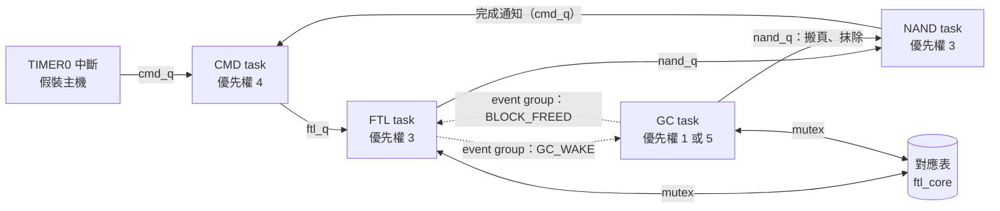

# rtos-ssd-lab

[English](README.md) | **繁體中文**

這個 repo 是我練 RTOS 的地方。RTOS（即時作業系統）是很多韌體在用的小型作業系統，負責決定「現在輪到哪個工作跑」。SSD 控制器裡的韌體，也是一堆工作在搶 CPU：接主機指令、查對應表、搬資料、做垃圾回收。

我用 FreeRTOS，跑在 QEMU 模擬的 Arm Cortex-M3 開發板（mps2-an385）上，所以不需要買硬體。內容分兩部分：

1. 三個 RTOS 基本練習：搶占、中斷加 queue、優先權反轉，每個都有實際量到的數字。
2. 一個迷你 SSD 韌體：把我另一個專案 [ftl-sim](https://github.com/KJLavender/ftl-sim) 的 FTL 核心改寫成 C，拆成幾個 task 跑在 FreeRTOS 上，再量 GC（垃圾回收）怎麼影響主機感受到的延遲。

## 環境

在 Linux 或 WSL2 的 Ubuntu 上：

```bash
sudo apt install gcc-arm-none-eabi libnewlib-arm-none-eabi qemu-system-arm make python3
git clone --recurse-submodules <這個 repo 的網址>
cd rtos-ssd-lab
```

我用的版本：arm-none-eabi-gcc 14.2、QEMU 10.2、FreeRTOS-Kernel V11.3.3（放在 `third_party/`，是 git submodule）。

## 怎麼跑

```bash
make run EX=ex01_preemption              # 練習 1，搶占式排程
make run EX=ex01_preemption PREEMPT=0    # 練習 1，改成合作式排程
make run EX=ex02_isr_queue               # 練習 2
make run EX=ex02_isr_queue VARIANT=BAD_ISR_PRIO   # 練習 2，故意把中斷優先權設錯
make run EX=ex03_priority_inversion      # 練習 3
make run EX=ex04_mini_ssd                # 迷你 SSD 韌體（約 20 秒）
make ftl-test                            # FTL 核心在 Linux 上的測試（需要 gcc）
make results                             # 全部跑一次，輸出存到 results/
```

每個練習跑完會自己結束 QEMU。如果卡住想手動離開，按 `Ctrl+A` 再按 `X`。

---

## 第一部分：RTOS 基本功

### 練習 1：搶占（Preemption）

兩個 task。L 優先權低，一直在做事，每做 1 ms 進度加一。H 優先權高，每 500 ms 醒來一次，做 2 ms 的事。H 每次醒來會記兩件事：從該醒的那個 tick 到真正拿到 CPU 隔了多久，還有它自己在跑的時候，L 的進度有沒有動。

| 排程方式 | H 喚醒延遲（平均） | H 喚醒延遲（最大） |
|---|---|---|
| 搶占式 | 7 µs | 7 µs |
| 合作式（L 每 50 ms 主動讓出一次） | 19.7 ms | 37.5 ms |

搶占式時，H 一醒來 L 就被暫停，H 跑的那 2 ms 裡 L 的進度完全沒動（例如 `L progress 497 -> 497`）。合作式時，H 只能等 L 自己讓出 CPU，延遲最多可以到 L 讓出的間隔 50 ms。表裡的平均值會隨跑的輪數變，重點是上限由 L 決定，H 管不到。

### 練習 2：中斷 + Queue（ISR → Task）

TIMER0 每 700 µs 發一次中斷，假裝主機送來一筆指令。ISR（中斷處理函式）只做兩件事：在指令上蓋時間戳，然後用 `xQueueSendFromISR` 丟進 queue。真正的處理（每筆 200 µs）交給處理指令的 task，它用 `xQueueReceive` 等，queue 是空的就睡覺。

同樣 1000 筆指令跑兩次，差別在 ISR 結尾有沒有呼叫 `portYIELD_FROM_ISR`：

| ISR 結尾 | 收到 / 送出 | 漏掉 | 順序錯 | 中斷到 task 的延遲（平均 / 最大） | 處理 task 的 CPU | idle 的 CPU |
|---|---|---|---|---|---|---|
| 有 `portYIELD_FROM_ISR` | 1000 / 1000 | 0 | 0 | 11 µs / 11 µs | 31% | 68% |
| 沒有 | 1000 / 1000 | 0 | 0 | 303 µs / 788 µs | 31% | 68% |

- 處理 task 只用了 31% 的 CPU，差不多就是 200 / 700。剩下的時間都在 idle，代表 queue 空的時候 task 真的在睡，沒有空轉。
- 沒有 yield 的話，task 雖然已經可以跑了，還是要等到下一次 tick（1 ms 一次）才換它上場，所以延遲變成幾百 µs。
- `VARIANT=BAD_ISR_PRIO` 把 TIMER0 的優先權設得比 `configMAX_SYSCALL_INTERRUPT_PRIORITY` 還緊急。這種中斷不能呼叫 FreeRTOS 的 API，FreeRTOS 一抓到就停下來：`ASSERT failed: .../ARM_CM3/port.c:803`。

### 練習 3：優先權反轉（Priority Inversion）

三個 task 共用一把鎖：

- L（低）：拿鎖，在鎖裡做 10 ms 的事
- H（高）：2 ms 後也要這把鎖
- M（中）：不需要鎖，3 ms 時醒來，做 50 ms 的事

另外有一個最高優先權的 CTRL task，照固定時間點叫醒它們，所以每一輪的劇本都一樣。同一個劇本，鎖分別用 binary semaphore 和 mutex 各跑 5 輪：

| 鎖的種類 | H 等鎖的時間（5 輪平均） |
|---|---|
| binary semaphore | 58.2 ms |
| mutex | 8.1 ms |

把 context switch 錄下來畫成時間軸（`#` 在跑，`^` 用借來的優先權在跑，`.` 在等鎖）：

```
[binary_semaphore]  1 char = 1 ms
     0         10        20        30        40        50        60
     |---------|---------|---------|---------|---------|---------|-
  H    ..........................................................#
  M     ##################################################
  L  ###                                                  #######

[mutex]  1 char = 1 ms
     0         10        20        30        40        50        60
     |---------|---------|---------|---------|---------|---------|-
  H    ........#
  M             ##################################################
  L  ##^^^^^^^^
```

用 binary semaphore 時，H 在等 L，L 卻被 M 搶走 CPU，所以 H 等了 L 剩下的 8 ms 再加上 M 的 50 ms。換成 mutex，H 一開始等，RTOS 就把 L 暫時升到 H 的優先權（`^`）。M 插不進來，H 只要等 L 把鎖裡的事做完。差別在 mutex 有「擁有者」，RTOS 知道該幫誰升級；semaphore 只是一個計數，沒有擁有者。

---

## 第二部分：迷你 SSD 韌體

### FTL 核心改寫成 C（`ftl/`）

FTL（Flash Translation Layer）是 SSD 韌體裡管「邏輯位址對應到哪個實體頁」的部分。NAND 不能覆寫，要更新資料就寫到新的頁，舊的頁作廢；空間不夠時，GC 挑一個 block，把還有效的頁搬走，再整塊抹除。多搬的量就是寫入放大（WAF）。

我從 ftl-sim 取最核心的部分改寫成 C：對應表、每個 block 的有效頁數、空 block 的佇列、greedy GC（挑有效頁最少的 block）。全部用固定大小的陣列，不用 malloc。

- `ftl/ftl_core.c`：只管對應表，不碰資料。
- `ftl/nand_sim.c`：NAND 模型，會檢查真實 NAND 的規則（同一頁抹除前只能寫一次、block 裡要照順序寫）。FTL 寫錯就會被記一筆。
- 同一份 C 程式在 Linux 上跑測試（`ftl/test/host_test.c`），也直接編進韌體。

跟 ftl-sim 對數字（`tools/compare_ftlsim.sh`，1024 個 block × 256 頁，結果在 `results/ftl_vs_ftlsim.txt`）：

| 比法 | OP 7% | OP 14% | OP 28% |
|---|---|---|---|
| 同一串寫入序列：C 版 / ftl-sim | 7.77288 / 7.77288 | 4.17441 / 4.17441 | 2.40311 / 2.40311 |
| 各自用自己的亂數（3 個 seed） | 差 -0.11% ～ +0.07% | 差 -0.17% ～ +0.03% | 差 -0.09% ～ +0.07% |

循序覆寫時，WAF 剛好是 1.00000。第一次比的時候，C 版的 WAF 一直比 ftl-sim 低 0.6%，換 seed 也一樣，所以不是亂數造成的。我讓兩邊吃同一串寫入序列，確定是規則不同，最後找到原因：ftl-sim 的 GC 一旦開始，會做到空 block 回到門檻以上才停；我的版本在 GC 開了新的寫入 block 時就提早停了。修正之後，同一串序列的結果完全一樣。

### 韌體架構（`ex04_mini_ssd/`）



| Task | 優先權 | 負責 | 用到的 RTOS 機制 |
|---|---|---|---|
| CMD | 4 | 收主機指令、轉給 FTL；收完成通知，算延遲、檢查讀回來的資料 | queue |
| FTL | 3 | 查、改對應表，產生 NAND 操作 | mutex、queue、event group |
| NAND | 3 | 一個 die，一次做一個操作；用 `vTaskDelay` 模擬讀 100 µs、寫 500 µs、抹除 3 ms | queue、task notification |
| GC | 1 或 5 | 空 block 不夠時，被 FTL 用 event group 叫醒，挑 victim、搬頁、抹除 | mutex、event group、task notification |

幾個設計重點：

- 對應表用 mutex 保護，FTL 和 GC 都會改它。
- 送 NAND 操作時還拿著 mutex，所以 `nand_q` 裡的順序一定跟對應表更新的順序一樣。這保證三件事：同一頁先寫後讀一定讀到新資料；GC 搬頁後的讀取會讀新位置；一個 block 的抹除，一定排在所有查到它的讀取後面。
- 寫入的完成時間算在 NAND 寫完之後（沒有模擬寫入快取）。

### 量測：GC 怎麼影響延遲

主機每 2 ms 送一筆指令（80% 寫、20% 讀，隨機位址），容量 128 個 block × 64 頁，OP 25%。每次先把碟寫滿、到穩定狀態，跑 1000 筆暖身，再量 4000 筆。比兩件事：

- GC 的方式：「一次搬完」是 victim 有幾頁就一口氣全部丟進 NAND 佇列；「節流」是主機每寫一頁，GC 才能搬 v / (P − v) 頁（v 是 victim 的有效頁數，P 是一個 block 的頁數），把搬移平均攤開。
- GC task 的優先權：比 CMD 低（1）或比 CMD 高（5）。

| GC 方式 | GC 優先權 | 寫入延遲 平均 | p50 | p99 | 最大 | WAF | CPU 閒置 |
|---|---|---|---|---|---|---|---|
| 一次搬完 | 低於 CMD | 9.0 ms | 6.0 ms | 27.2 ms | 27.2 ms | 2.84 | 91% |
| 一次搬完 | 高於 CMD | 9.4 ms | 6.3 ms | 28.3 ms | 28.9 ms | 2.83 | 91% |
| 節流 | 低於 CMD | 1.1 ms | 0.6 ms | 4.1 ms | 6.8 ms | 3.16 | 89% |
| 節流 | 高於 CMD | 1.2 ms | 0.65 ms | 4.6 ms | 6.8 ms | 3.17 | 89% |

看到的事：

- GC 的優先權幾乎沒影響。CPU 有九成時間閒著，瓶頸在 NAND，不在 CPU，所以調 task 優先權改變不了誰先用到 NAND。GC 優先權高一點，延遲反而稍微差一點。
- 真正有差的是 GC 怎麼分配 NAND 的時間。一次搬完時，一個 victim 平均要搬 41 頁（約 25 ms），後面進來的主機指令全部排在後面，p99 是 27 ms。節流之後，p99 降到 4.1 ms，最大延遲從 27 ms 降到 6.8 ms。
- 節流的代價是 WAF 從 2.84 變成 3.16。節流模式要多留 3 個空 block 當緩衝，可用的 OP 變少；GC 也比較早動手，會搬到一些等一下就會被覆寫的資料。這跟 ftl-sim 裡「背景 GC 換來的是延遲比較穩，不是比較少寫入」的結論一樣。
- 四組都沒有發生主機寫入要等 GC 的情況（foreground stall = 0）。一次搬完的延遲高峰，來自主機指令在 NAND 佇列裡排在 GC 後面。

資料正確性：四組跑完都做了這些檢查，結果都是 0。

- 每筆讀取都跟主機記錄的「最後寫入的值」比對（包含暖身期間）
- 跑完後整碟逐頁讀一遍比對
- 對應表跟反向表、有效頁數的一致性檢查（`ftl_check`）
- NAND 規則違反次數

### 如果是真的 SSD

- 真的 SSD 控制器多半有好幾顆核心（例如一顆接主機指令、一顆跑 FTL、一顆管 NAND 通道），核心之間用訊息傳遞。這時比較常見的做法是讓 FTL 獨佔對應表，GC 要改就丟訊息給 FTL，不用 mutex。這裡用 mutex，是因為單核心上比較簡單，也剛好用上練習 3 的東西。
- 真的 NAND 有很多 channel 和 die 可以同時動作，這裡只有一個 die。
- 每一頁只存一個 32-bit 的資料值和它的 LPN，不是 4 KB 的資料。
- 沒有斷電保護、ECC、wear leveling、寫入快取。

## 數字怎麼量的

- QEMU 不是逐週期精準的模擬器，也沒有實作 Cortex-M 的 DWT cycle counter。我用板子上的 TIMER1 當 25 MHz 的自由計數器來量時間。
- QEMU 加了 `-icount shift=5,align=off,sleep=off`，讓模擬時間只跟執行了幾條指令有關，跟主機忙不忙無關。同一個練習跑兩次，輸出一模一樣。
- 所以這些數字是 QEMU 的虛擬時間，適合拿來比較兩種做法，不代表真實晶片上的絕對值。NAND 的時間是我設定的模型值。
- 「做 X ms 的事」是用開機時校正過的空迴圈來燒 CPU。被搶占的話，實際花的時間會變長，這樣才能模擬「固定的工作量」。

## 目錄

```
bsp/          開發板相關：啟動碼、連結腳本、UART 輸出、計時、FreeRTOSConfig.h、context switch 紀錄
ex01_preemption/          練習 1
ex02_isr_queue/           練習 2
ex03_priority_inversion/  練習 3
ex04_mini_ssd/            迷你 SSD 韌體（CMD、FTL、NAND、GC 四個 task）
ftl/                      FTL 核心和 NAND 模型（C，不用 malloc），ftl/test/ 是 Linux 上的測試
tools/timeline.py         把 context switch 紀錄畫成文字時間軸
tools/compare_ftlsim.sh   跟 ftl-sim 比 WAF
results/                  make results 的輸出
third_party/FreeRTOS-Kernel   FreeRTOS 核心（submodule）
```

## 授權

- FreeRTOS-Kernel：MIT
- `bsp/CMSIS/` 裡的標頭檔從 FreeRTOS 的 MPS2 QEMU demo 複製過來，原始授權（Arm 的 Apache-2.0 和 BSD-3-Clause）寫在各檔案開頭
